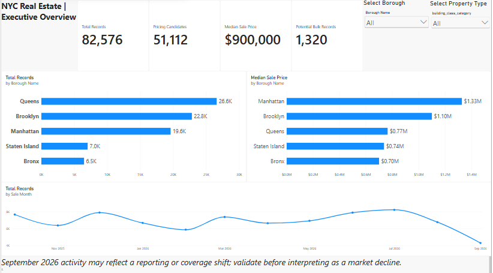
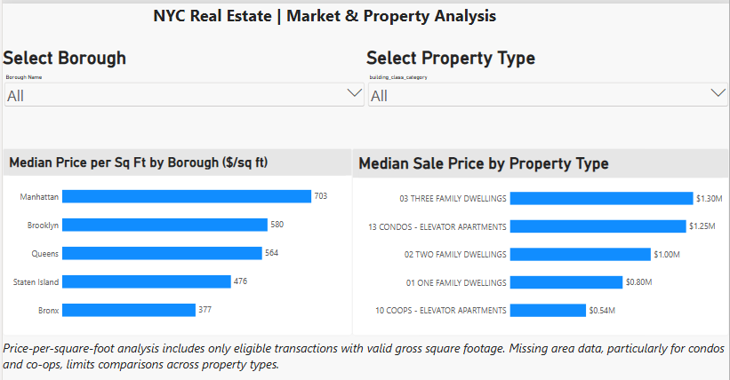
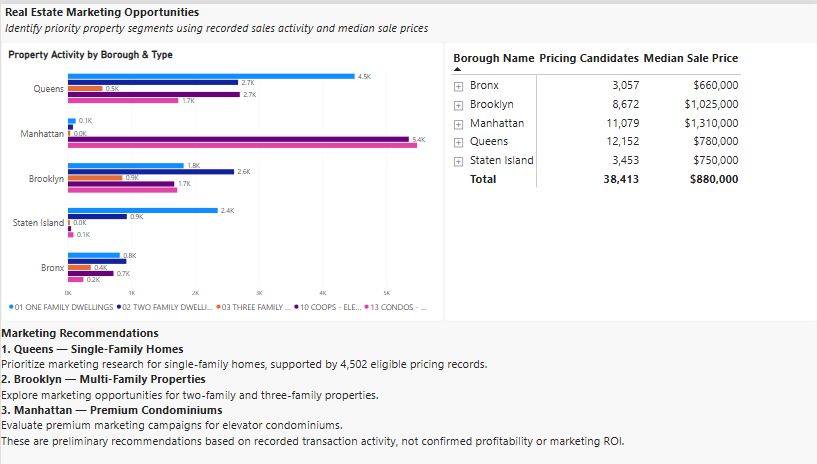

# NYC Real Estate Analytics | Market Opportunity Research

**SQL (Google BigQuery) · Power BI · DAX · Data Quality · Business Analysis**

An end-to-end analysis of **82,576 New York City real estate records** covering **October 1, 2025 through September 30, 2026**. The objective was to identify borough–property segments worth prioritizing for **marketing research and controlled pilot campaigns**, while separating potentially misleading records from standard pricing analysis.

> **Business question:** Where should the business focus its real estate marketing and opportunity research?

## Project at a glance

| Metric | Result |
|---|---:|
| Recorded transactions | 82,576 |
| Standard pricing candidates | 51,112 |
| Overall median sale price (eligible records) | $900,000 |
| Price-per-square-foot candidates | 22,442 |
| Zero-price records | 28,475 |
| Missing gross square footage | 37,716 |
| Potential bulk-sale records (heuristic) | 1,320 |

The analytical dataset retains all source rows and uses eligibility flags rather than deleting potentially meaningful records. **Pricing candidates are analytical records, not independently verified arm's-length sales.**

## Business objectives

- Compare recorded transaction activity across NYC boroughs.
- Assess median sale prices by borough and property class.
- Identify property-type segments for further research.
- Communicate data quality limitations before recommending marketing action.

## Workflow

1. **Data inspection:** checked types, missing values, zero/low prices, dates, and duplicates.
2. **Cleaning:** standardized column names and prepared typed data in BigQuery.
3. **Quality flags:** isolated records relevant for pricing and area-based metrics.
4. **Potential bulk-sale detection:** flagged suspicious repeated combinations of borough, block, date, and price across multiple lots.
5. **EDA:** compared transaction counts and medians by borough, property type, and month.
6. **Dashboard:** built three Power BI pages with slicers, DAX measures, and an opportunity matrix.
7. **QA:** reconciled key dashboard metrics to the analytical results and tested interactions.

## Key findings

### Borough activity and pricing

| Borough | Total records | Standard pricing candidates | Median eligible sale price |
|---|---:|---:|---:|
| Queens | 26,602 | 15,241 | $765,000 |
| Brooklyn | 22,838 | 13,200 | $1,100,000 |
| Manhattan | 19,615 | 14,516 | $1,328,000 |
| Staten Island | 7,033 | 4,202 | $736,450 |
| Bronx | 6,488 | 3,953 | $700,000 |

**Interpretation:** Queens has the most recorded activity, while Manhattan has the highest median price among standard pricing candidates. Neither measure by itself demonstrates demand growth or marketing profitability.

### Segments for follow-up research

| Borough / segment | Eligible pricing records | Recommended next step |
|---|---:|---|
| Queens — one-family dwellings | 4,502 | Investigate neighborhood-level single-family campaign opportunities. |
| Brooklyn — two-family dwellings | 2,610 | Research buyers, neighborhoods, and lead generation potential. |
| Brooklyn — three-family dwellings | 855 | Test whether a specialized multi-family audience exists. |
| Manhattan — elevator condominiums | 5,484 | Examine premium condo targeting and marketing economics. |

These are **research priorities**, not proven investment opportunities or estimated returns.

## Power BI dashboard

## Dashboard Screenshots

### Executive Overview


### Market & Property Analysis


### Marketing Opportunities


The report includes three pages:

## Executive Case Study Report

The full report documents the business problem, data cleaning methodology, SQL analysis, key findings, marketing recommendations, and data limitations.

[Read the Full Case Study Report (PDF)](report/NYC_Real_Estate_Case_Study.pdf)

1. **Executive Overview** — total records, eligible pricing records, median sale price, potential bulk records, borough comparisons, and monthly activity.
2. **Market & Property Analysis** — property-class median prices and median sale price per gross square foot by borough.
3. **Marketing Opportunities** — residential segment comparisons, an interactive matrix, and preliminary marketing recommendations.

**Dashboard files:**
- [Power BI report (`.pbix`)](dashboard/Real_Estate_Analytics.pbix)
- [Exported dashboard (`.pdf`)](dashboard/Real_Estate_Analytics.pdf)

## Data quality and caveats

- **Zero-price records:** 28,475 transactions have a recorded sale price of zero; they are excluded from standard median-price calculations.
- **Low positive prices:** 1,669 records show a price between $1 and $10,000; the project flags these as unsuitable for standard pricing analysis under its working rule.
- **Missing area:** 37,716 rows lack gross square footage. Condo and co-op categories are especially affected, limiting comparisons using price per square foot.
- **Potential bulk transactions:** 60 candidate groups, comprising 1,320 records, were identified via a heuristic (same borough, block, sale date, and sale price, with at least five distinct lots and price ≥ $1 million). **These have not been verified as true bulk sales.** They are flagged rather than deleted.
- **Reporting coverage:** September 2026 displays an unusual drop in Staten Island records. Reporting/completeness changes should be checked before interpreting this as a market decline.
- **Decision limits:** The dataset does not establish leads, buyer demand, acquisition costs, conversion rates, profit, or campaign ROI.

## SQL files

| File | Purpose |
|---|---|
| [`01_data_cleaning.sql`](sql/01_data_cleaning.sql) | Reconstructed cleaning and standardization procedure |
| [`02_data_quality.sql`](sql/02_data_quality.sql) | Data-quality checks |
| [`03_bulk_sale_detection.sql`](sql/03_bulk_sale_detection.sql) | Read-only bulk-sale heuristic review |
| [`04_analytical_table.sql`](sql/04_analytical_table.sql) | Reconstructed analytical flags and table logic |
| [`05_exploratory_analysis.sql`](sql/05_exploratory_analysis.sql) | Exploratory analysis queries |

**Reproducibility note:** These SQL files were reconstructed for portfolio documentation from the documented analysis rules and results; they are **not verified verbatim exports of the original BigQuery job history**. Review against the existing source schema before running. In particular, scripts containing `CREATE OR REPLACE TABLE` can overwrite existing tables. The outputs shown above were validated during the original project workflow, but the reconstructed scripts have not been rerun end-to-end as a separate reproducibility test.

## Recommended business actions

1. **Queens:** test single-family buyer targeting after neighborhood-level validation.
2. **Brooklyn:** investigate two- and three-family niches with demand and lead-cost data.
3. **Manhattan:** evaluate premium elevator condo campaigns using listing, audience, and profitability data.
4. **Before scaling:** validate bulk-sale flags, check reporting completeness, and measure pilot campaign outcomes.

## Repository structure

```text
NYC-Real-Estate-Analytics/
├── README.md
├── sql/
│   ├── 01_data_cleaning.sql
│   ├── 02_data_quality.sql
│   ├── 03_bulk_sale_detection.sql
│   ├── 04_analytical_table.sql
│   └── 05_exploratory_analysis.sql
├── dashboard/
│   ├── Real_Estate_Analytics.pbix
│   └── Real_Estate_Analytics.pdf
├── report/
└── images/
```

## Next improvements

- Verify and export the historical SQL queries from BigQuery job history.
- Run reconstructed SQL against a separate sandbox dataset to validate reproducibility.
- Incorporate listing inventory, marketing spend, lead quality, and conversion data.
- Analyze trends at neighborhood/ZIP level with data-coverage checks.
- Add screenshots of all three final dashboard pages to `images/`.

---

*Portfolio case study created to demonstrate SQL-based data preparation, analytical judgment, Power BI dashboarding, and business communication.*
